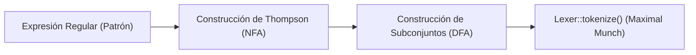

# GeoGrid3D - Analizador Léxico (Entrega 1/3)
**Institución:** Escuela de Ingeniería de Sistemas - Universidad de Los Andes (ULA)  
**Asignatura:** Compiladores  
**Profesor:** José Castro, Alejandro Mujica  
**Equipo:** ACE (Grupo 3)  
**Integrantes:**
- **Edixon Toro** - C.I: 27.364.279
- **Mikael Pizzi** - C.I: 27.777.243

---

## 1. Breve Descripcion 

**GeoGrid3D** es un compilador y traductor para un Lenguaje de Dominio Específico de naturaleza declarativa, orientado al diseño y maquetación procedural de escenarios tridimensionales basados en cuadrículas. El sistema toma como entrada archivos fuente con extensión `.gg` y los traduce a archivos de escena nativos `.tscn` compatibles con el motor de videojuegos **Godot Engine 4.x**.

El objetivo de esta primera entrega consiste en el desarrollo formal y funcional del Analizador Léxico utilizando la biblioteca **DeSiGNAR** en **C++17**.

---

## 2. Especificación Léxica del Lenguaje

El analizador léxico procesa el flujo de caracteres del código fuente `.gg` y clasifica cada secuencia en tokens formales.

### 2.1. Palabras Reservadas 

Las palabras reservadas poseen significado léxico prioritario y no pueden ser utilizadas como identificadores generales. Se clasifican funcionalmente en:

| Categoría                      | Token                | Lexema       | Descripción                                                   |
| :----------------------------- | :------------------- | :----------- | :------------------------------------------------------------ |
| **Bloques Estructurales**      | `KEYWORD_GRID`       | `grid`       | Delimita el bloque de configuración métrica de la cuadrícula. |
|                                | `KEYWORD_TERRAIN`    | `terrain`    | Delimita el bloque de pintura de materiales y superficies.    |
|                                | `KEYWORD_ENTITIES`   | `entities`   | Delimita el bloque de colocación y reglas de entidades.       |
| **Atributos**                  | `KEYWORD_SIZE`       | `size`       | Especifica las dimensiones de casillas de la cuadrícula.      |
|                                | `KEYWORD_CELL_SIZE`  | `cell_size`  | Tamaño en metros reales por celda en el espacio 3d.           |
|                                | `KEYWORD_DEFAULT`    | `default`    | Asigna el material base por defecto del terreno.              |
| **Directivas de Terreno**      | `KEYWORD_PAINT`      | `paint`      | Asigna color o material a una coordenada específica.          |
|                                | `KEYWORD_FILL`       | `fill`       | Relleno rectangular entre dos puntos coordenados.             |
|                                | `KEYWORD_PATH`       | `path`       | Traza una línea o camino continuo entre dos puntos.           |
| **Directivas de Entidades**    | `KEYWORD_LIMIT`      | `limit`      | Restricción máxima de instancias para un tipo de entidad.     |
|                                | `KEYWORD_SPAWN`      | `spawn`      | Instancia una entidad en una coordenada puntual o baricentro. |
|                                | `KEYWORD_ARRANGE`    | `arrange`    | Dispone entidades en anillo circular alrededor de otra.       |
|                                | `KEYWORD_DISTRIBUTE` | `distribute` | Distribuye entidades uniformemente en el perímetro.           |
|                                | `KEYWORD_SCATTER`    | `scatter`    | Esparce aleatoriamente entidades en casillas desocupadas.     |
| **Modificadores y Conectores** | `KEYWORD_AT`         | `at`         | Conector de posición destino (`spawn "boss" at ...`).         |
|                                | `KEYWORD_AROUND`     | `around`     | Conector de referencia para ordenamiento circular.            |
|                                | `KEYWORD_ON`         | `on`         | Conector de área perimetral (`on perimeter`).                 |
|                                | `KEYWORD_FROM`       | `from`       | Coordenada inicial en operaciones de área o ruta.             |
|                                | `KEYWORD_TO`         | `to`         | Coordenada terminal en operaciones de área o ruta.            |
|                                | `KEYWORD_CENTER`     | `center`     | Descriptor simbólico del centro o baricentro de la matriz.    |
|                                | `KEYWORD_PERIMETER`  | `perimeter`  | Descriptor del contorno exterior de la cuadrícula.            |
|                                | `KEYWORD_COUNT`      | `count`      | Cantidad numérica de elementos a generar.                     |
|                                | `KEYWORD_RADIUS`     | `radius`     | Radio en casillas para distribuciones radiales.               |

### 2.2. Operadores y Signos de Puntuación

| Token | Lexema | Significado |
| :--- | :--- | :--- |
| `OP_LESS_EQUAL` | `<=` | Operador relacional de cota para directivas `limit`. |
| `OP_ASSIGN` | `=` | Operador de asignación (ej. para pintar colores). |
| `PUNCT_LBRACE` | `{` | Inicio de bloque jerárquico. |
| `PUNCT_RBRACE` | `}` | Fin de bloque jerárquico. |
| `PUNCT_LPAREN` | `(` | Apertura de tupla de coordenadas. |
| `PUNCT_RPAREN` | `)` | Cierre de tupla de coordenadas. |
| `PUNCT_COMMA` | `,` | Separador de coordenadas `(x, y)`. |
| `PUNCT_COLON` | `:` | Separador de atributo y valor. |
| `PUNCT_SEMICOLON` | `;` | Delimitador y terminador de sentencia. |

### 2.3. Literales e Identificadores

* **`FLOAT_LITERAL`:** Números reales con punto decimal (ej: `2.0`, `1.5`). Expresión regular: `Dígito+ \. Dígito+`.
* **`INT_LITERAL`:** Números enteros (ej: `0`, `16`, `20`). Expresión regular: `Dígito+`.
* **`STRING_LITERAL`:** Cadenas de caracteres delimitadas por comillas dobles (ej: `"boss"`, `"piso_roca"`, colores hexadecimales `"#8B0000"`).
* **`ID`:** Nombres de identificadores definidos por el usuario que inician con letra o guión bajo, seguidos de caracteres alfanuméricos.
* **Comentarios y Espacios (Descartables):** Comentarios de una línea iniciados con `//` y espacios en blanco son procesados por el motor lexico y filtrados para entregar únicamente tokens significativos al compilador.

---

## 3. Fundamentos Teóricos e Implementación con DeSiGNAR

El analizador utiliza el módulo léxico de la biblioteca didáctica **DeSiGNAR** (`automata.hpp` y `lexer.hpp`):



### 3.1. Adaptación a las limitaciones sintácticas de DeSiGNAR
Se construyeron definiciones modulares mediante alternancia explícita porque DeSIGNAR no soporta esas clases abreviadas:
```cpp
const std::string LOWER = "a|b|c|d|e|f|g|h|i|j|k|l|m|n|o|p|q|r|s|t|u|v|w|x|y|z";
const std::string UPPER = "A|B|C|D|E|F|G|H|I|J|K|L|M|N|O|P|Q|R|S|T|U|V|W|X|Y|Z";
const std::string DIGIT = "0|1|2|3|4|5|6|7|8|9";
const std::string LETTER = "(" + LOWER + "|" + UPPER + "|_)";
const std::string ALPHANUM = "(" + LOWER + "|" + UPPER + "|_|" + DIGIT + ")";
```

### 3.2. Regla de Coincidencia Más Larga y Orden de Registro
El escáner simula en paralelo los autómatas finitos deterministas de todas las reglas registradas:
1. **Gana la coincidencia más larga:** Ante el texto `2.0`, `FLOAT_LITERAL` consume 3 caracteres (`2.0`), superando a `INT_LITERAL` que consumiría solo el primer dígito (`2`).
2. **Desempate por orden de registro:** Ante la palabra clave `grid`, tanto la regla `KEYWORD_GRID` como el patrón genérico `ID` reconocerían una longitud de 4 caracteres. Para garantizar que `grid` sea reconocido como palabra reservada y no como nombre de variable, las 22 palabras reservadas se registran estrictamente antes que el `ID`

### 3.3. Manejo de Errores Léxicos y Posicionamiento
Si la entrada contiene un caracter que no puede ser consumido por ninguna regla (por ejemplo `@`, `$`), `DeSiGNAR` lanza una excepción `std::runtime_error`. La implementación en `GeoGrid::tokenize_geogrid` captura este evento, correlaciona el *offset* con el texto fuente original y emite un mensaje  con la línea y columna exactas:
```text
[ERROR LEXICO DETECTADO]
Detalle: Fallo lexico en Linea 5, Columna 5 (offset 132): Caracter no reconocido '@'
```

De esto ya hay un ejemplo donde se prueba. 

---

## 4. Estructura del Repositorio

```text
GeoGrid3D_ACE/
├── CMakeLists.txt              # Configuración de compilación CMake (C++17)
├── README.md                   # Documentación del proyecto 
├── include/
│   └── geogrid_lexer.hpp       # Motor y registro de tokens de GeoGrid3D
├── src/
│   └── main.cpp                # Ejecutable CLI del escáner y suite de pruebas
└── examples/
    ├── nivel_terror.gg         # Caso de estudio 1 (Juego de Terror)
    ├── mazmorra_nivel.gg       # Caso de estudio 2 (Mazmorra y Pasillos)
    └── error_lexico.gg         # Caso de prueba de captura de excepciones
```

---

## 5. Instrucciones de Compilación y Ejecución

### Requisitos Previos
* Compilador de C++ con soporte para **C++17** 
* CMake 3.20 o superior (opcional si se compila directamente con g++).

### Compilación con CMake
```bash
# 1. Crear carpeta de compilación
mkdir build && cd build

# 2. Configurar el proyecto
cmake ..

# 3. Compilar el ejecutable
cmake --build .
```

### Compilación Directa con MinGW / GCC
```bash
g++ -std=c++17 -O2 -static -static-libgcc -static-libstdc++ \
    -I ../../DeSiGNAR/include -I include \
    src/main.cpp ../../DeSiGNAR/build/libDesignar.a \
    -o geogrid_lexer.exe
```

---

## 6. Demostración y Pruebas

El analizador incluye un modo de pruebas que evalua automáticamente los casos propuestos:

```bash
./geogrid_lexer --test
```

O para analizar un archivo individual:

```bash
./geogrid_lexer examples/nivel_terror.gg
```

### Ejemplo de Salida (Extracto):
```text
_________________________________________________________________
Analizando: examples/nivel_terror.gg
_________________________________________________________________
[EXITO] Analisis lexico completado sin errores.

LINEA   COL     OFFSET    CATEGORIA             LEXEMA
-----------------------------------------------------------------
2       1       72        KEYWORD_GRID          "grid"
2       6       77        PUNCT_LBRACE          "{"
3       5       83        KEYWORD_SIZE          "size"
3       9       87        PUNCT_COLON           ":"
3       11      89        PUNCT_LPAREN          "("
3       12      90        INT_LITERAL           "20"
3       14      92        PUNCT_COMMA           ","
3       16      94        INT_LITERAL           "20"
3       18      96        PUNCT_RPAREN          ")"
3       19      97        PUNCT_SEMICOLON       ";"
4       5       103       KEYWORD_CELL_SIZE     "cell_size"
4       14      112       PUNCT_COLON           ":"
4       16      114       FLOAT_LITERAL         "2.0"
4       19      117       PUNCT_SEMICOLON       ";"
5       1       119       PUNCT_RBRACE          "}"
...
15      5       298       KEYWORD_LIMIT         "limit"
15      11      304       STRING_LITERAL        ""estatua""
15      21      314       OP_LESS_EQUAL         "<="
15      24      317       INT_LITERAL           "4"
15      25      318       PUNCT_SEMICOLON       ";"
17      5       325       KEYWORD_SPAWN         "spawn"
17      11      331       STRING_LITERAL        ""boss""
17      18      338       KEYWORD_AT            "at"
17      21      341       KEYWORD_CENTER        "center"
17      27      347       PUNCT_SEMICOLON       ";"
-----------------------------------------------------------------
Total de tokens significativos: 74
```
